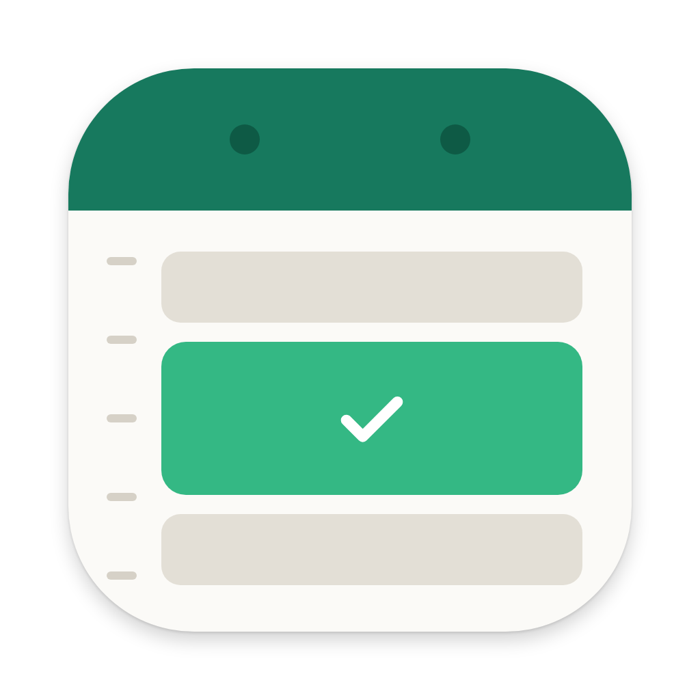

# FreeSlots

<p align="center">
  
</p>

Google カレンダーの「予定が入っていない時間帯」を、メールに貼れる形でクリップボードにコピーする macOS のメニューバー常駐アプリ。

```
・9月25日(金) 10:00〜12:00、14:00〜18:00
・9月28日(月) 9:00〜18:00
```

## 使い方

1. メニューバーのカレンダーアイコンをクリック
2. 候補にしたい日付をクリック（複数選べる。もう一度クリックで解除）
3. 「コピー」（または Return）→ メールに貼り付け

歯車から条件を変えられる。

| 設定 | 既定値 | 内容 |
| --- | --- | --- |
| 開始・終了 | 9:00〜18:00 | 候補にする時間帯 |
| 最短の長さ | 60分 | これより短い空きは出さない |
| 時刻の刻み | 30分 | 10:45 に終わる予定の後は 11:00 から、のようにそろえる |
| 予定の前後の余白 | なし | 移動・準備の時間として予定の前後を空ける |
| 終日の予定は無視する | オン | 祝日や誕生日などの終日予定で1日が埋まらないようにする |
| 出力形式 | 1日1行 | 「1枠1行」にもできる |
| 対象カレンダー | すべて | 空き時間の計算に使うカレンダー |

次の予定は「空き」として扱う。

- Google カレンダーで「予定なし（Free）」にした予定
- キャンセルされた予定、自分が辞退した予定
- 今日を選んだ場合の、今より前の時間

## インストール

macOS 14 以降。Apple Silicon・Intel のどちらでも動く。

1. [Releases](https://github.com/umiyuri777/free-slots/releases/latest) から `FreeSlots-x.x.zip` をダウンロードして展開する
2. `FreeSlots.app` を「アプリケーション」フォルダに入れて開く（ウインドウは出ず、メニューバーにアイコンが出る）

ソースからビルドする場合は `make install`（build/FreeSlots.app を作って /Applications にコピーし起動）。

### 「開けません」と出たとき

Apple の公証（notarization）を受けていないので、ダウンロードしたアプリは初回に macOS に止められる。次のどちらかで開けるようになる。

- 一度開こうとした後、システム設定 →「プライバシーとセキュリティ」の下の方にある「このまま開く」を押す
- ターミナルで次を実行する

  ```bash
  xattr -dr com.apple.quarantine /Applications/FreeSlots.app
  ```

## セットアップ

Google カレンダーは macOS のカレンダーデータベース（EventKit）経由で読む。Google API の登録や OAuth は不要。

1. システム設定 →「インターネットアカウント」で Google アカウントを追加し、「カレンダー」をオンにする
2. FreeSlots を起動し、カレンダーへのアクセスを求められたら「許可」
3. 設定の「ログイン時に起動」をオンにすると常駐する

## 開発

```bash
make test     # 空き時間計算とテキスト整形のテスト
make run      # build/FreeSlots.app をビルドして起動
make release  # GitHub Releases に添付する build/FreeSlots-<バージョン>.zip を作る
```

リリースは `make release` の後、`gh release create v<バージョン> build/FreeSlots-<バージョン>.zip` で作る。バージョンは `Resources/Info.plist` の `CFBundleShortVersionString`。

- `Sources/FreeSlotsCore` … 空き時間の計算（`FreeSlotCalculator`）とテキスト整形（`SlotTextFormatter`）。UI・EventKit に依存しない
- `Sources/FreeSlots` … メニューバー UI（SwiftUI の `MenuBarExtra`）と EventKit の読み取り
- `scripts/build-app.sh` … SwiftPM のビルド結果を .app に包んで署名

既定では ad-hoc 署名なので、ビルドし直すとカレンダーへのアクセスを再度求められることがある。
Apple Development 証明書があれば `SIGN_IDENTITY="Apple Development: ..." make install` で署名すると許可が引き継がれる。
